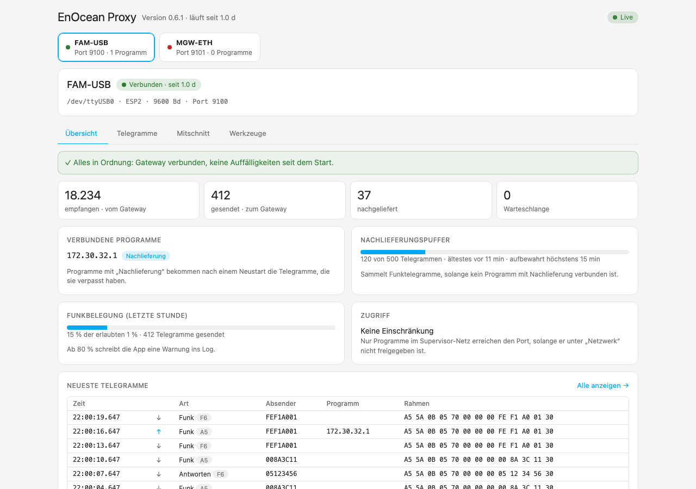
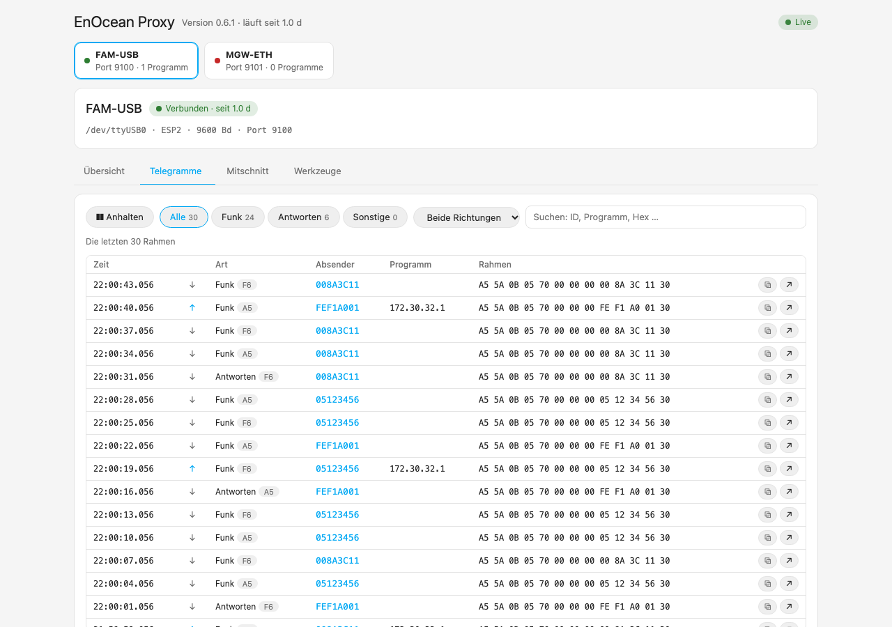
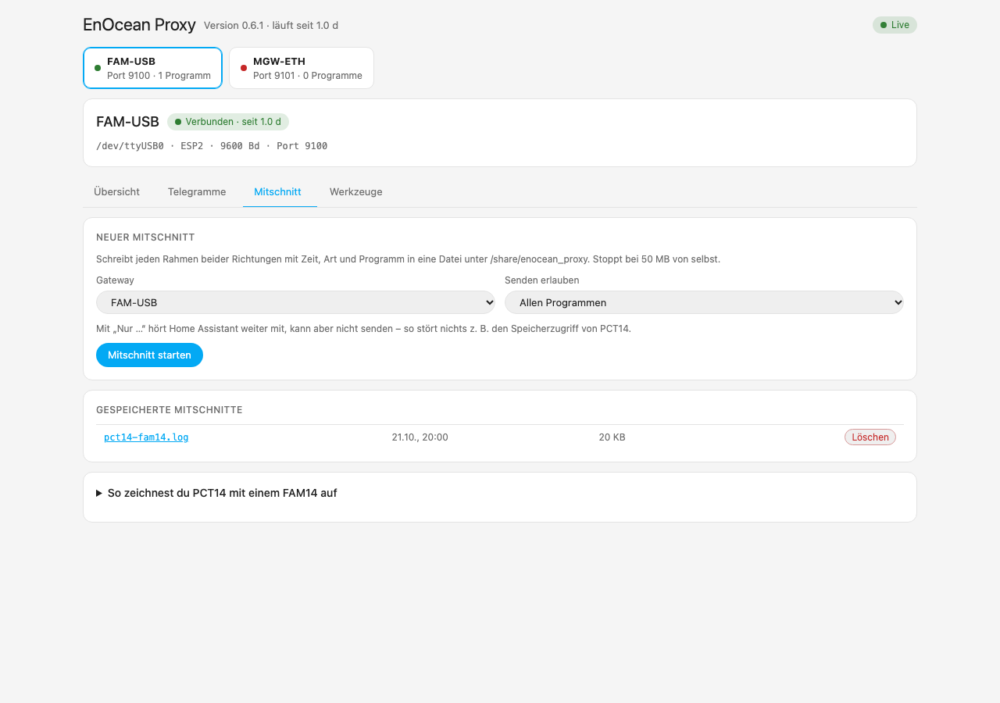
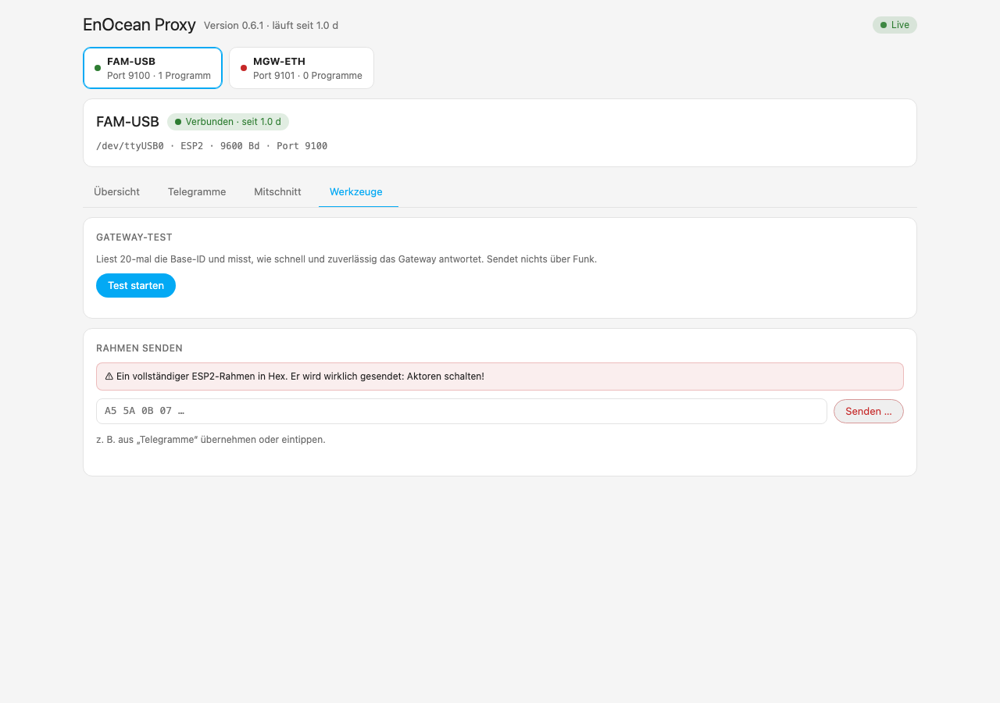

<p align="center">
  
</p>

<h1 align="center">EnOcean Proxy</h1>

<p align="center">
  Ein EnOcean-Gateway mit mehreren Programmen teilen und beim Neustart von Home Assistant kein Telegramm verlieren.
</p>

<p align="center">
  <a href="https://www.home-assistant.io/"></a>
  <a href="https://github.com/bertel2020/HA-Enocean-Proxy/releases"></a>
  <a href="https://github.com/bertel2020/HA-Enocean-Proxy/actions/workflows/ci.yml"></a>
  <a href="LICENSE"></a>
</p>

<p align="center">
  <a href="https://buymeacoffee.com/bertel2020"></a>
  <a href="https://ko-fi.com/bertel2020"></a>
  <a href="https://paypal.me/RobertoMartins"></a>
</p>

<p align="center"><em><a href="https://github.com/bertel2020/HA-Enocean-Proxy/blob/main/README.md">English version</a></em></p>

EnOcean Proxy ist eine Home-Assistant-App (früher Add-on), die die Verbindung zu deinen EnOcean-Gateways hält und jedes davon auf einem TCP-Port anbietet. Beliebig viele Programme können dasselbe Gateway gleichzeitig nutzen, und während Home Assistant neu startet, hört die App weiter zu und liefert die verpassten Telegramme danach nach.

Sie gehört zur [EnOcean-Eltako-Integration](https://github.com/bertel2020/HA-Enocean-Eltako) und funktioniert mit allem, was rohes ESP2 oder ESP3 über TCP spricht.

> Braucht Home Assistant OS oder Supervised (Apps laufen unter dem Supervisor). Noch nicht mit echter Hardware getestet, nicht produktiv einsetzen.

## Screenshots

Die Screenshots zeigen Beispieldaten.

<p align="center">
  
</p>

| Telegramme | Mitschnitt |
| --- | --- |
|  |  |

| Werkzeuge |
| --- |
|  |

## Warum EnOcean Proxy?

Ein serielles Gateway wie das FAM-USB kann nur ein Programm nutzen. Sobald die alte `eltako`-Integration, die neue, eo_man oder ein Mitschnitt-Werkzeug es gleichzeitig wollen, verliert eines. Dazu kommt: Jeder Neustart von Home Assistant bedeutet ein paar Minuten ohne Telegramme. Eine Rollade, die in der Zwischenzeit am Taster bewegt wurde, zeigt die falsche Position, Zählerstände und „zuletzt gesehen“ stimmen nicht.

Der Proxy besitzt das Gateway und sitzt zwischen ihm und deinen Programmen. Am Gateway und an deinen Geräten muss nichts geändert werden.

## Highlights

- **Ein Gateway, viele Programme**: Jedes Telegramm vom Gateway geht an jedes verbundene Programm; Telegramme der Programme gehen einzeln und nie ineinander zum Gateway, und die Antwort auf einen Befehl geht an das Programm zurück, das ihn gesendet hat.
- **Nachlieferung nach einem Neustart**: Telegramme, die ankamen, während Home Assistant weg war, kommen in ihrer ursprünglichen Reihenfolge und mit ihrer Empfangszeit an, sodass Rollladenpositionen, Zählerstände und Schaltzustände stimmen.
- **Von Home Assistant gefunden**: Die Gateways werden über die Supervisor-Discovery gemeldet; du bestätigst sie und wählst das Modell. Keine Ports zum Eintippen.
- **Statusseite in der Seitenleiste**: je Gateway eine Übersicht, die in einfachen Worten sagt, was Aufmerksamkeit braucht, die Telegramme live mit Absender-ID, Suche und Filtern, Mitschnitte und Werkzeuge.
- **Funkbelegung**: Die App schätzt die Sendezeit von allem, was gesendet wird, und zeigt den Anteil am 1-%-Limit; ab 80 % schreibt sie eine Warnung ins Log.
- **Mitschnitte**: Jeden Rahmen in beide Richtungen aufzeichnen, zum Beispiel was PCT14 einem FAM14 sagt, auf Wunsch mit dem Gateway nur für ein Programm.
- **Werkzeuge**: Gateway-Test und einzelnen Rahmen senden, mit Prüfung von Synchronbytes, Länge und Prüfsumme, bevor er rausgeht.
- **Sicher als Standard**: Die Ports bleiben im Supervisor-Netz, solange du sie nicht freigibst, und `allowed_clients` begrenzt, wer sich verbinden darf. Fehlt ein serieller Port oder ein Gateway, verbindet sich die App selbst neu, die Programme bleiben verbunden.

## Schnellstart

1. Das Repository mit dem Button unten zu Home Assistant hinzufügen und **EnOcean Proxy** unter **Einstellungen → Apps → App-Store** installieren.

   [](https://my.home-assistant.io/redirect/supervisor_add_addon_repository/?repository_url=https%3A%2F%2Fgithub.com%2Fbertel2020%2FHA-Enocean-Proxy)

   Ohne Button: **Einstellungen → Apps → App-Store → ⋮ → Repositories**, `https://github.com/bertel2020/HA-Enocean-Proxy` eintragen.

2. In der **Konfiguration** der App die Gateways eintragen (ein serieller Port, am besten der stabile Pfad `/dev/serial/by-id/...`, oder `tcp://host:port`) und die App starten.

3. Die Gateways erscheinen in Home Assistant als entdeckt (**EnOcean Proxy**). Jedes bestätigen und das Modell wählen. Die Nachlieferung wird für dich eingeschaltet.

4. **EnOcean Proxy** in der Seitenleiste öffnen, um das Gateway und seine Telegramme zu sehen.

Ein serieller Port kann nur von einem Programm genutzt werden: Trage ihn aus jedem anderen Programm aus und lass diese stattdessen den Proxy verbinden.

Mehr zur Konfiguration, zur Statusseite, zu Mitschnitten, Funkbelegung und Netzwerk-Einstellungen steht in der **[App-Dokumentation](enocean_proxy/DOCS.md)** (englisch).

## Sicherheit in Kürze

- Standardmäßig sind die Ports nicht am Host geöffnet; Home Assistant erreicht die App im Supervisor-Netz.
- Wer einen Port erreicht, kann Telegramme an deine Aktoren senden. Wenn du Ports ins LAN öffnest, begrenze sie mit `allowed_clients`.
- Einen Rahmen von der Statusseite zu senden, sendet ihn wirklich: Aktoren reagieren.

Details: [Netzwerk und Sicherheit](enocean_proxy/DOCS.md#network-and-security) und [Grenzen](enocean_proxy/DOCS.md#limits).

## Entwicklung

```bash
python -m pip install -r requirements_test.txt
ruff check .
mypy
python -m pytest
```

Die CI veröffentlicht für jede neue Version auf `main` fertige Images (`ghcr.io/bertel2020/{amd64,aarch64}-enocean-proxy`); `config.yaml` nennt sie als `image`, der Supervisor lädt sie also, statt zu bauen. Bei jeder Änderung `version` erhöhen: Der Publish-Job überspringt eine Version, die es schon gibt.

## Änderungsprotokoll

Die Versionshinweise stehen in [enocean_proxy/CHANGELOG.md](enocean_proxy/CHANGELOG.md) (englisch).

## Dank

EnOcean Proxy baut auf der Arbeit anderer auf:

- [grimmpp](https://github.com/grimmpp) (Philipp Grimm) für [home-assistant-eltako](https://github.com/grimmpp/home-assistant-eltako), [eltako14bus](https://github.com/grimmpp/eltako14bus) und [esp2_gateway_adapter](https://github.com/grimmpp/esp2_gateway_adapter), den Ursprung der Eltako-Unterstützung. `eltako14bus` geht auf Christian Amsüss und Energy Harvesting Solutions (2016–2020) zurück.
- [chrysn](https://github.com/chrysn), Johannes Bosecker, Cedric Van Labeke und LHBL2003, die zu `home-assistant-eltako` beigetragen haben.
- Kimmo Huoman ([kipe/enocean](https://github.com/kipe/enocean), über den Fork [mak-gitdev/enocean](https://github.com/mak-gitdev/enocean)) für die EnOcean-Protokollbibliothek.

## Haftungsausschluss

EnOcean Proxy ist ein privat entwickeltes, kostenloses Open-Source-Projekt und wird
ohne Gewährleistung oder Garantie bereitgestellt. Die Nutzung erfolgt auf eigene
Verantwortung; insbesondere kann keine Garantie für einen fehlerfreien Betrieb sowie
für die Vollständigkeit der nachgelieferten Telegramme übernommen werden. **Die App kann
Telegramme an deine Aktoren senden, wenn ein Programm oder die Statusseite es verlangt.
Verlasse dich nicht auf sie für sicherheitsrelevante Funktionen.**

## Lizenz

Dieses Projekt steht unter der [MIT-Lizenz](LICENSE).
Copyright 2026 Roberto / bertel2020.
