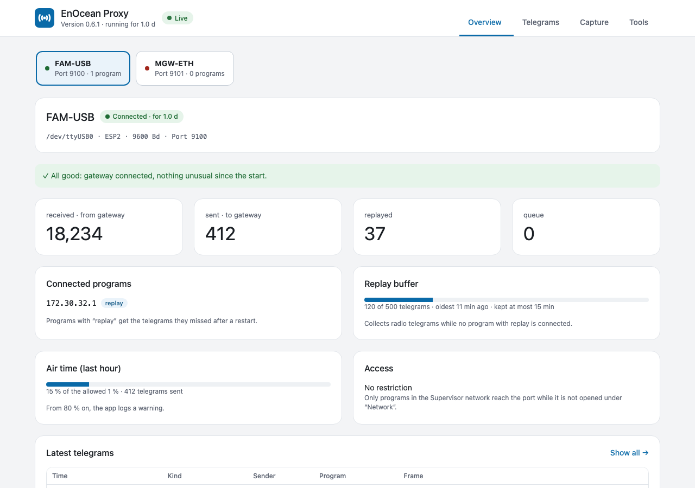
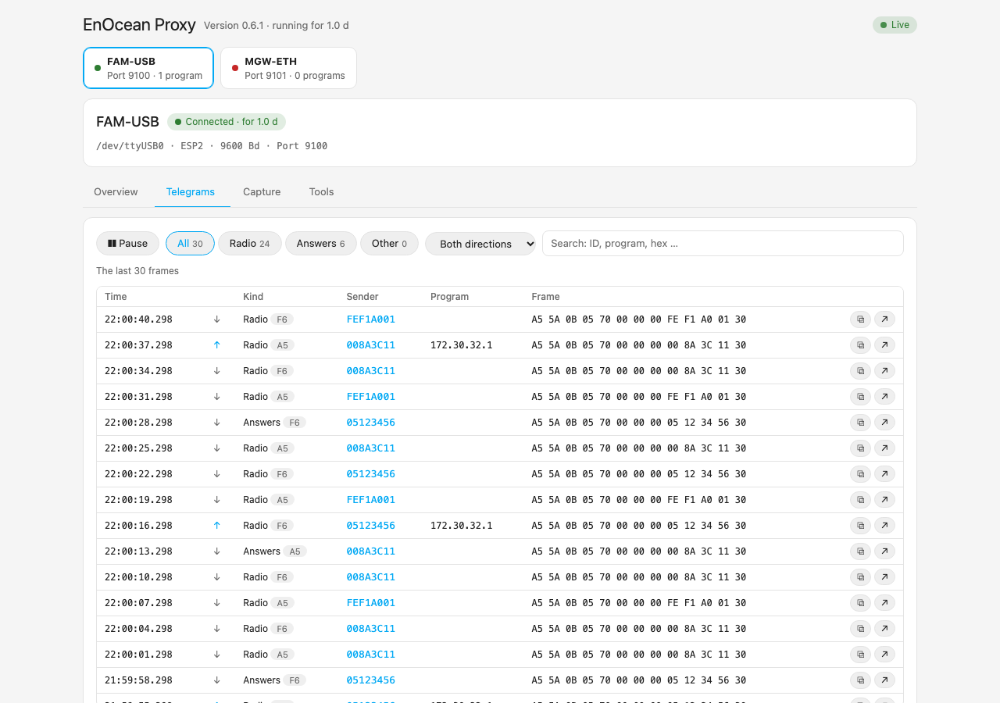
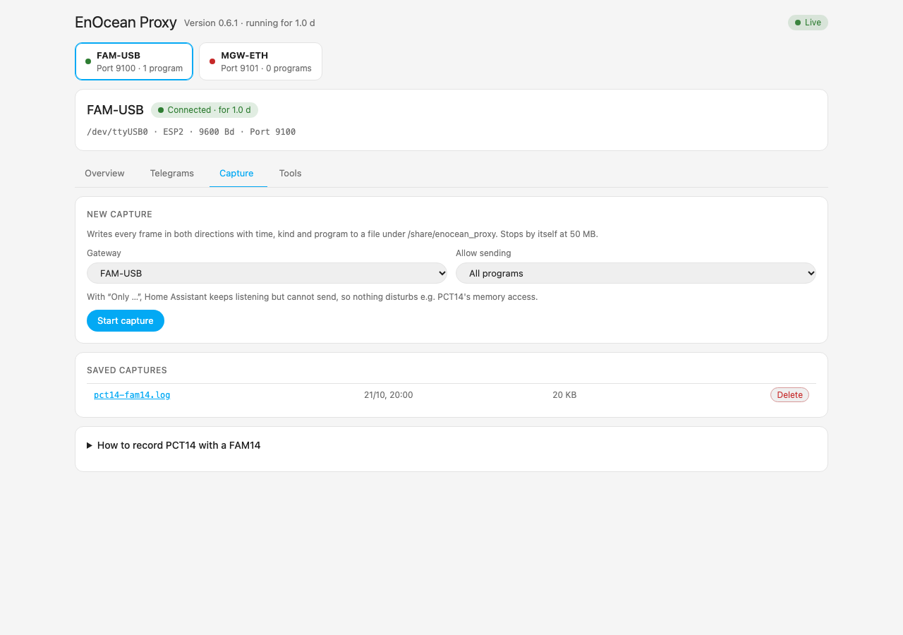
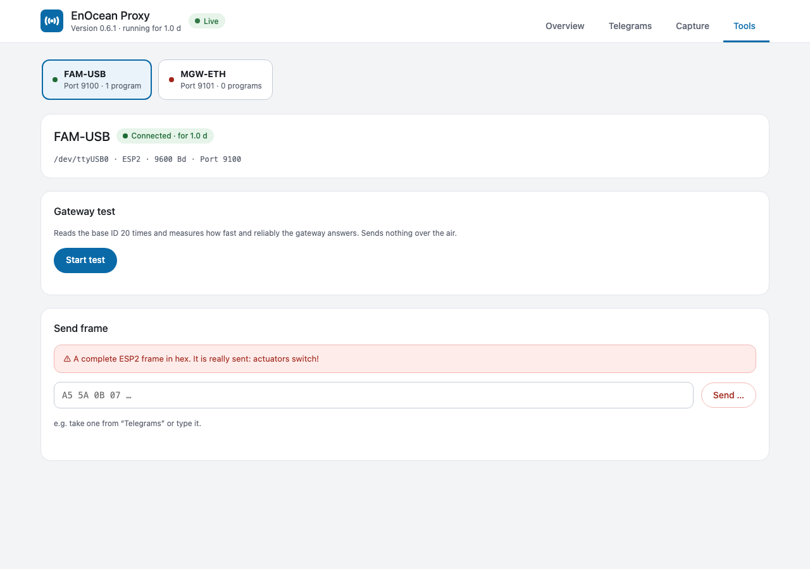

<p align="center">
  
</p>

<h1 align="center">EnOcean Proxy</h1>

> [!WARNING]
> **This app is discontinued.** Its EnOcean gateways now live in the
> [Device Proxy app](https://github.com/bertel2020/HA-Device-Proxy), with the same behaviour for the EnOcean Eltako integration
> (replay, read-only status, discovery) plus history, notifications and MQTT entities.
> Moving: install the Device Proxy, open *Import / Export* → *Fetch from the EnOcean Proxy
> app*, stop this app, then take the gateways over. This app gets no new features.

<p align="center">
  Share one EnOcean gateway with several programs and lose no telegram while Home Assistant restarts.
</p>

<p align="center">
  <a href="https://www.home-assistant.io/"></a>
  <a href="https://github.com/bertel2020/HA-Enocean-Proxy/releases"></a>
  <a href="https://github.com/bertel2020/HA-Enocean-Proxy/actions/workflows/ci.yml"></a>
  <a href="LICENSE"></a>
</p>

<p align="center">
  <a href="https://buymeacoffee.com/bertel2020"></a>
  <a href="https://ko-fi.com/bertel2020"></a>
  <a href="https://paypal.me/RobertoMartins"></a>
</p>

<p align="center"><em><a href="https://github.com/bertel2020/HA-Enocean-Proxy/blob/main/README.de.md">Deutsche Version</a></em></p>

EnOcean Proxy is a Home Assistant app (formerly add-on) that keeps the connection to your EnOcean gateways and offers each one on a TCP port. Any number of programs can use the same gateway at the same time, and while Home Assistant restarts the app keeps listening and hands the missed telegrams back afterwards.

It belongs to the [EnOcean Eltako integration](https://github.com/bertel2020/HA-Enocean-Eltako) and works with anything that speaks raw ESP2 or ESP3 over TCP.

> Needs Home Assistant OS or Supervised (apps run under the Supervisor). Not tested on real hardware yet, do not use it in production.

## Screenshots

The screenshots show sample data.

<p align="center">
  
</p>

| Telegrams | Capture |
| --- | --- |
|  |  |

| Tools |
| --- |
|  |

## Why EnOcean Proxy?

A serial gateway such as the FAM-USB can be used by one program only. As soon as the old `eltako` integration, the new one, eo_man or a capture tool want it at the same time, one of them loses. On top of that, every Home Assistant restart means a few minutes without telegrams: a cover that was moved by a wall switch meanwhile shows the wrong position, meter readings and "last seen" are off.

The proxy owns the gateway and sits between it and your programs. Nothing about the gateway or your devices has to change.

## Highlights

- **One gateway, many programs**: every telegram from the gateway reaches every connected program; telegrams the programs send go to the gateway one at a time, never interleaved, and the answer to a command goes back to the program that sent it.
- **Replay after a restart**: telegrams that arrived while Home Assistant was away are delivered in their original order, with their reception time, so cover positions, meter readings and switch states stay right.
- **Found by Home Assistant**: the gateways are announced through Supervisor discovery; you confirm them and pick the model. No ports to type in.
- **Status page in the sidebar**: per gateway an overview that says in plain words what needs attention, the telegrams live with sender ID, search and filters, captures and tools.
- **Air time**: the app estimates the radio time of everything sent and shows the share of the 1 % limit; at 80 % it logs a warning.
- **Captures**: record every frame in both directions, for example what PCT14 says to a FAM14, optionally with the gateway reserved for one program.
- **Tools**: gateway test and sending a single frame, with a check of sync bytes, length and checksum before it goes out.
- **Safe by default**: the ports stay inside the Supervisor network unless you open them, and `allowed_clients` limits who may connect. The app reconnects to a missing serial port or gateway on its own while programs stay connected.

## Quick start

1. Add the repository to Home Assistant with the button below, install **EnOcean Proxy** under **Settings → Apps → App store**.

   [](https://my.home-assistant.io/redirect/supervisor_add_addon_repository/?repository_url=https%3A%2F%2Fgithub.com%2Fbertel2020%2FHA-Enocean-Proxy)

   Without the button: **Settings → Apps → App store → ⋮ → Repositories**, add `https://github.com/bertel2020/HA-Enocean-Proxy`.

2. Enter your gateways in the app's **Configuration** (a serial port, best the stable `/dev/serial/by-id/...` path, or `tcp://host:port`) and start the app.

3. The gateways show up in Home Assistant as discovered (**EnOcean Proxy**). Confirm each one and pick its model. Replay is switched on for you.

4. Open **EnOcean Proxy** in the sidebar to see the gateway and its telegrams.

A serial port can be used by one program only: remove it from every other program and let those connect to the proxy instead.

More on the configuration, the status page, captures, air time and network settings is in the **[app documentation](enocean_proxy/DOCS.md)**.

## Safety in short

- By default the ports are not opened on the host; Home Assistant reaches the app inside the Supervisor network.
- Anyone who can reach a port can send telegrams to your actuators. If you open ports to the LAN, limit them with `allowed_clients`.
- Sending a frame from the status page really sends it: actuators react.

Details: [Network and security](enocean_proxy/DOCS.md#network-and-security) and [Limits](enocean_proxy/DOCS.md#limits).

## Development

```bash
python -m pip install -r requirements_test.txt
ruff check .
mypy
python -m pytest
```

CI publishes prebuilt images for every new version on `main` (`ghcr.io/bertel2020/{amd64,aarch64}-enocean-proxy`); `config.yaml` names them as `image`, so the Supervisor pulls them instead of building. Bump `version` with every change: the publish job skips a version that already exists.

## Changelog

See [enocean_proxy/CHANGELOG.md](enocean_proxy/CHANGELOG.md) for release notes.

## Thanks

EnOcean Proxy builds on the work of others:

- [grimmpp](https://github.com/grimmpp) (Philipp Grimm) for [home-assistant-eltako](https://github.com/grimmpp/home-assistant-eltako), [eltako14bus](https://github.com/grimmpp/eltako14bus) and [esp2_gateway_adapter](https://github.com/grimmpp/esp2_gateway_adapter), the origin of the Eltako support. `eltako14bus` goes back to Christian Amsüss and Energy Harvesting Solutions (2016–2020).
- [chrysn](https://github.com/chrysn), Johannes Bosecker, Cedric Van Labeke and LHBL2003, who contributed to `home-assistant-eltako`.
- Kimmo Huoman ([kipe/enocean](https://github.com/kipe/enocean), via the fork [mak-gitdev/enocean](https://github.com/mak-gitdev/enocean)) for the EnOcean protocol library.

## Disclaimer

EnOcean Proxy is a privately developed, free open-source project and is provided
without warranty or guarantee. Use is at your own risk; in particular, no guarantee
can be given for error-free operation or for the completeness of the telegrams
delivered. **The app can send telegrams to your actuators when a program or the status
page asks it to. Do not rely on it for safety-relevant functions.**

## License

This project is released under the [MIT License](LICENSE).
Copyright 2026 Roberto / bertel2020.
